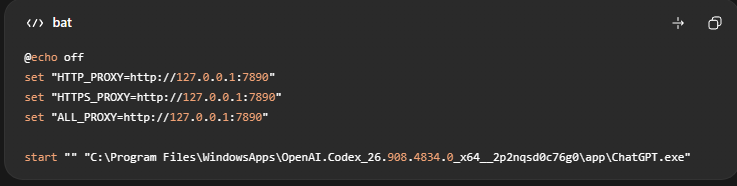
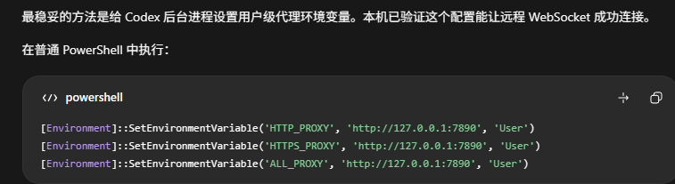

<div align="center">

<h1>Codex 连接修复</h1>

<b>Windows · Codex Desktop（微软商店版）</b> · <code>反复重连 5 次 · 远程控制 remote 失败</code>
<b>简体中文</b> | <a href="./README.en.md">English</a>

不开 TUN 模式，只给 Codex 挂代理 —— 微信、浏览器照常直连<br>

<a href="https://github.com/gdSHAY/codex-connect-fix/stargazers"></a>
<a href="https://github.com/gdSHAY/codex-connect-fix/forks"></a>
<a href="https://github.com/gdSHAY/codex-connect-fix/issues"></a>


<br>


<br><br>

<a href="./AGENT_PROMPTS.md">🤖 部署提示词：让 Agent 一键搞定</a> · <a href="./scripts/install-shortcut.ps1">方案 A 启动器</a> · <a href="./scripts/set-user-proxy.ps1">方案 B 用户级变量</a>

</div>

---

**Codex 每发一条指令，都要雷打不动地重连 5 次才开始思考**（见下图），手机远程连电脑也失败。根因不是网速差，而是 **Codex 的部分子进程压根没用上系统代理**。本项目给两种零副作用的修法：一个只给 Codex 用的启动脚本，或一组用户级代理环境变量。**两种都不用开代理软件的 TUN 模式**，微信、浏览器等其它软件照常直连。

> ⚠️ 需要你**自备**本地 HTTP 代理（Clash / FlClash / Mihomo，默认 7890）—— 本项目不含代理。
> ⚠️ 改完必须**完全退出 Codex 再重启**，已经在跑的进程不会回头读环境变量。

## 🤖 直接把这段发给 Agent

复制下面整段，发给一个有**本机 PowerShell 权限**的 Agent（Claude Code / WorkBuddy / Codex 本身都行）。它会先只读取证、再动手，最后把体检输出贴给你，而不是只说一句「已完成」。

```text
帮我修 Windows 上「Codex 反复重连 / 手机远程连接失败」的问题。
根因已确认：Codex 的部分子进程没继承系统代理。修法是启动 Codex 前先设好代理环境变量。

1) 先只读：Get-AppxPackage -Name OpenAI.Codex 拿到 InstallLocation 与 Version
   （目录名带版本号，绝不写死）；用 Get-NetTCPConnection -State Listen -LocalPort 7890
   确认代理在监听 —— 没监听就停下来告诉我先开代理软件。
2) 方案 A（必做）：把 scripts/ 下 4 个文件放到 %APPDATA%\Codex-launcher\，然后运行
   powershell -NoProfile -ExecutionPolicy Bypass -File .\install-shortcut.ps1
   硬约束：.cmd / .vbs 里不能有任何非 ASCII 字符（cmd 按 OEM 代码页解析会串行）。
3) 方案 B（只在我要用远程连接时做）：运行 scripts/set-user-proxy.ps1，
   写入用户级 HTTP_PROXY / HTTPS_PROXY / ALL_PROXY 与 NO_PROXY。用 'User' 不用 'Machine'，
   不要用 setx。
4) 验收：跑 start-codex-proxy.cmd --check，把完整输出贴给我；并明确告知
   Codex 必须完全退出后重启才生效。

禁止：开 TUN 模式；改 Codex 安装文件；改系统级(Machine)环境变量。任何一步失败就停下报错。
```

完整版（含分步验收要求）与英文版见 [`AGENT_PROMPTS.md`](./AGENT_PROMPTS.md)。

## 1️⃣ 能解决什么问题

| 你遇到的症状 | 能解决 | 用哪个方案 |
| --- | --- | --- |
| Codex 每发一条指令都要重连 5 次才响应 | ✅ | A |
| Codex 一直转圈、提示 request timed out | ✅ | A |
| **手机远程连接电脑、Codex 远程（remote）失败** | ✅ | **B** |
| Codex 控制浏览器 / 调用联网子进程失败 | ✅ | A（B 更保险） |
| 开 TUN 模式后微信卡死、国内网站变慢 | ✅ 且不用开 TUN | A + B |
| 商店更新后旧启动脚本报「找不到文件」 | ✅ | 本项目不写死版本号 |
| 你根本没有本地代理 | ❌ | —— |

<div align="center">

<br>
<sub>图 1：修之前的样子 —— 每条指令都卡在「正在重新连接 5/5 / request timed out」。</sub>
</div>

## 2️⃣ 使用的方法

### 方案 A：专用启动脚本（推荐，影响面最小）

在启动 Codex **之前**，把 3 个代理变量设进当前进程，再启动 Codex —— 它和它拉起的子进程就都带上代理了，其它软件完全不受影响。

```bat
@echo off
set "HTTP_PROXY=http://127.0.0.1:7890"
set "HTTPS_PROXY=http://127.0.0.1:7890"
set "ALL_PROXY=http://127.0.0.1:7890"
set "NO_PROXY=localhost,127.0.0.1,::1"
start "" "C:\Program Files\WindowsApps\OpenAI.Codex_26.908.4834.0_x64__2p2nqsd0c76g0\app\ChatGPT.exe"
```

<div align="center">

<br>
<sub>图 2：这就是全部内容，短到可以手抄。⚠️ 但注意最后一行 —— 路径里的 <code>26.908.4834.0</code> 是<strong>写死</strong>的，商店一更新目录名就变（实测已变成 <code>26.928.3736.0</code>），双击必然报「找不到文件」。本项目改为运行时用 <code>Get-AppxPackage</code> 解析，商店更新后再也不用改。</sub>
</div>

一键安装（自动处理版本解析、隐藏黑窗、桌面官方图标）：

```powershell
powershell -NoProfile -ExecutionPolicy Bypass -File .\scripts\install-shortcut.ps1
```

### 方案 B：用户级代理环境变量（解决远程 / 后台进程）

**为什么还需要 B**：手机远程连接、Codex 的 remote 能力，用的是 Codex 的**后台进程**。后台进程不是从方案 A 的脚本拉起的，继承不到那份进程级变量 —— 只有把变量设到用户级才能覆盖它。

<div align="center">

<br>
<sub>图 3：用户级环境变量。关键在于第三个参数 <code>'User'</code> —— 写进当前用户（注册表 HKCU\Environment），不需要管理员；不要用 <code>'Machine'</code>，也不要为了省事用 <code>setx</code>（有 1024 字符截断、超长时静默失败）。</sub>
</div>

```powershell
# 设置
powershell -NoProfile -ExecutionPolicy Bypass -File .\scripts\set-user-proxy.ps1
# 查看当前状态
powershell -NoProfile -ExecutionPolicy Bypass -File .\scripts\set-user-proxy.ps1 -Status
# 一键撤销
powershell -NoProfile -ExecutionPolicy Bypass -File .\scripts\set-user-proxy.ps1 -Undo
```

> ⚠️ **B 是有代价的**：用户级变量会被你**所有新启动的进程**继承，git / pip / curl 这类命令行工具会开始走代理，个别软件可能因此变慢或失败。所以默认用 A，只在确实需要远程能力时再加 B；不需要了就 `-Undo`。

### 两个方案怎么选

| | 方案 A 专用启动器 | 方案 B 用户级变量 |
| --- | --- | --- |
| 影响范围 | 只有从它启动的 Codex 进程树 | 当前用户下所有新进程 |
| 能修远程 / 后台进程 | ❌ | ✅ |
| 会不会影响微信等 | 完全不影响 | ⚠️ 会继承，可能变慢 |
| 需要管理员 | ❌ | ❌ |
| 适合谁 | 只想让 Codex 走代理 | 要用远程控制、或不想记着从哪里启动 |

**两个方案可以同时用，互不冲突。**

## 3️⃣ 原理与优势

### 为什么开 TUN 模式能修，却没人愿意常开

TUN 模式把**全部流量**强制接管进代理隧道，于是微信、国内网站、内网服务全被塞进代理链路 —— 结果是卡死、断线、DNS 变慢。为了修一个 Codex 而牺牲整台机器的上网体验，代价太大，而这个问题根本不需要全局接管。

### 为什么「设个环境变量」就够了

`HTTP_PROXY` / `HTTPS_PROXY` / `ALL_PROXY` 是程序读取代理的事实标准。进程在**创建时**读一次环境变量，**子进程继承父进程的环境** —— 所以只要在启动 Codex 之前把变量设好，Codex 以及它后续拉起的浏览器控制、联网子进程就都会走代理。再配上 `NO_PROXY=localhost,127.0.0.1,::1`，本机回环保持直连，Codex 与本地 helper 的通信不会被绕进代理。

### 那为什么不干脆直接改系统变量？

因为系统级 / 用户级变量会被**所有**新进程继承 —— 你只想修 Codex，却顺带把其它软件也拽进了代理。方案 A 用 `setlocal` 把变量限制在本次 cmd 及其子进程内，**cmd 退出即消失**，是影响面最小的做法。方案 B 之所以存在，仅仅是为了覆盖「不从启动器拉起的后台进程」这一种情况，代价也随之而来 —— 所以它可选、可撤销。

### 实测记录：为什么必须运行时解析版本

| 项目 | 值 |
| --- | --- |
| 旧启动脚本写死的商店包目录 | `OpenAI.Codex_26.908.4834.0_x64__2p2nqsd0c76g0` |
| 本次核对时的实际商店包目录 | `OpenAI.Codex_26.928.3736.0_x64__2p2nqsd0c76g0` |
| 结论 | 目录名确实随更新变化，写死的脚本必然失效 |

## 📥 下载与安装

到 [**Releases**](../../releases/latest) 下载 `codex-connect-fix-v1.0.1.zip`，解压后执行：

```powershell
powershell -NoProfile -ExecutionPolicy Bypass -File .\install-shortcut.ps1
```

**依赖：无** —— 只用 Windows 自带的 PowerShell 5.1 与 Windows Script Host。
`-ExecutionPolicy Bypass` 不能省：本机执行策略默认为 `Restricted`，不加会被拒绝运行。

## ⚠️ 能力边界

- **不含代理**：本项目只把地址告诉 Codex，代理本身要你自己开（默认端口 7890，改一行即可）。
- **必须先完全退出 Codex**：环境变量只在进程创建时生效，已在运行的进程改不动。
- **不改 Codex 任何文件**：方案 A 不写注册表；方案 B 只写 `HKCU\Environment` 一个位置，且可一键撤销。不动系统代理设置。
- **只支持商店版**：包名必须是 `OpenAI.Codex`；自己装的 Codex CLI 不适用。
- **只认 HTTP 形式**：注入的是 `http://` 变量，纯 SOCKS 端口需要在代理软件里开 HTTP 混合端口。
- **方案 B 是双刃剑**：见上文代价说明，随时可 `-Undo`。

## 🗂 项目结构

```text
AGENT_PROMPTS.md                   中英双语「部署提示词」，直接发给 Agent 用
scripts/install-shortcut.ps1       方案 A 一键安装：复制文件 / 提取官方图标 / 建快捷方式（-Uninstall 卸载）
scripts/start-codex-proxy.cmd      方案 A 入口：设好 4 个变量，再调用下面的核心逻辑
scripts/start-codex-proxy.ps1      方案 A 核心：解析商店版本 -> 体检 -> 启动（--check 只体检）
scripts/run-codex-hidden.vbs       隐藏黑窗的包装器
scripts/set-user-proxy.ps1         方案 B：写用户级变量（-Status 查看 / -Undo 撤销）
docs/symptom-reconnect-5times.jpg  图 1 故障现场
docs/method-a-launcher-cmd.png     图 2 方案 A 启动脚本
docs/method-b-user-env.png         图 3 方案 B 用户级变量
```

## ❓ 常见问题

<details>
<summary><b>照着做了还是重连，怎么办？</b></summary>

按顺序排三件事：① Codex 是不是**完全退出**后才重启的（含托盘图标）；② 代理端口是否真的在监听 —— 跑 `start-codex-proxy.cmd --check` 看 `代理端口` 那一行；③ 是否只做了方案 A，而你的场景（远程 / 后台进程）需要方案 B。
</details>

<details>
<summary><b>双击后提示「找不到文件」是怎么回事？</b></summary>

你用的还是把版本号写死的旧脚本。用本项目的 `install-shortcut.ps1` 重装一次即可，它会在运行时解析当前商店版本。
</details>

<details>
<summary><b>设了方案 B 之后 git / pip 变慢或报错</b></summary>

属于预期内 —— 用户级变量会被所有新进程继承。要么给该工具单独设置 `NO_PROXY`，要么直接撤销：`set-user-proxy.ps1 -Undo`。
</details>

<details>
<summary><b>这个项目会动我的 Codex 或系统吗？</b></summary>

不会。方案 A 只在自己进程内设变量，然后用 `Start-Process` 拉起 Codex；方案 B 只写 `HKCU\Environment` 一个位置且可一键撤销。**不修改 Codex 任何文件、不改系统级变量、不改系统代理设置。**
</details>

## 📄 合规与免责

- 本仓库与 OpenAI **无任何关联**，非官方项目。Codex、ChatGPT 及相关图标是 OpenAI 的商标与著作权财产。
- 本工具**不修改 Codex 程序本体**，不绕过任何付费、鉴权或地区限制；只在本机为进程设置代理环境变量 —— 代理从哪来、能不能用，完全取决于你自己。
- 请自行确认你的网络环境与所用代理服务符合当地法律法规及 OpenAI 服务条款。
- 脚本按「现状」提供，不附带任何担保。因使用本工具造成的网络配置变化、账号风险或其它后果，**由使用者自行承担**。

## 📮 联系

| | |
| --- | --- |
| 问题反馈 | [Issues](https://github.com/gdSHAY/codex-connect-fix/issues)（请附 `--check` 的完整输出） |
| 仓库 | <https://github.com/gdSHAY/codex-connect-fix> |
| 相关项目 | [codex-sandbox-doctor](https://github.com/gdSHAY/codex-sandbox-doctor)：修复 Codex 沙箱「Windows 设置未完成」 |

## 📄 许可

**MIT License**，见 [LICENSE](./LICENSE)。

<div align="center">
<sub>本 README 采用「<b>简体中文</b> / <a href="./README.en.md">English</a>」双语，可用顶部链接切换。</sub>
</div>
